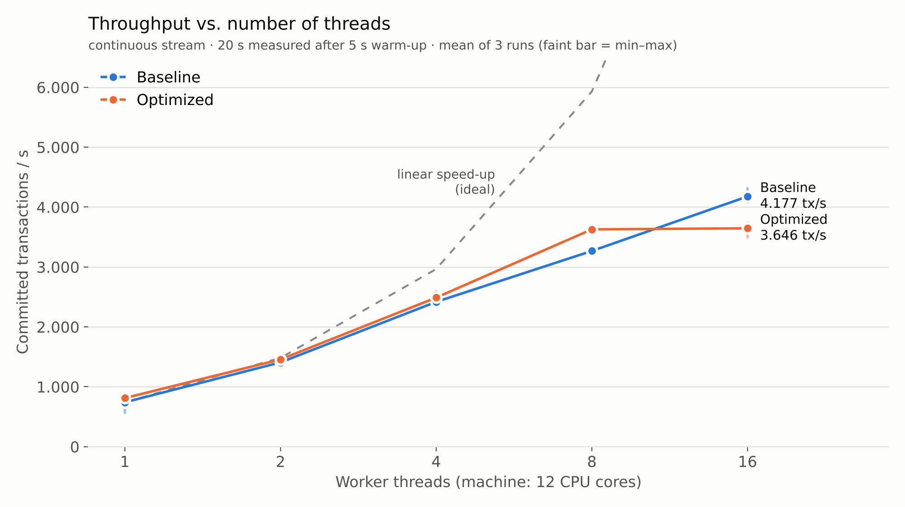
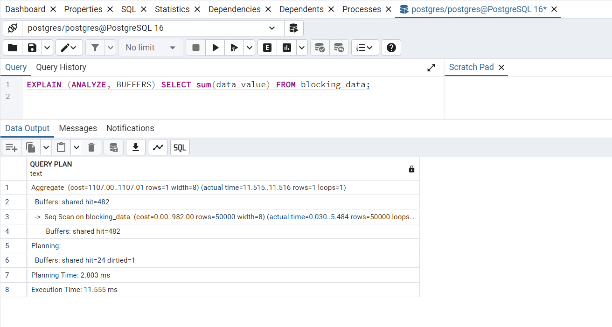
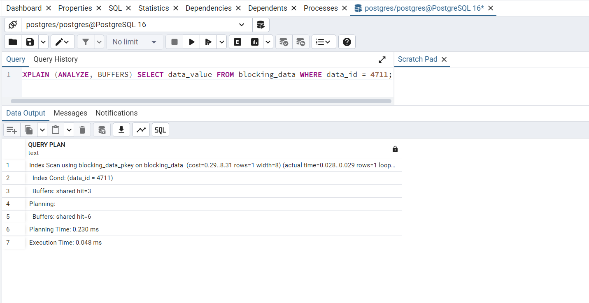
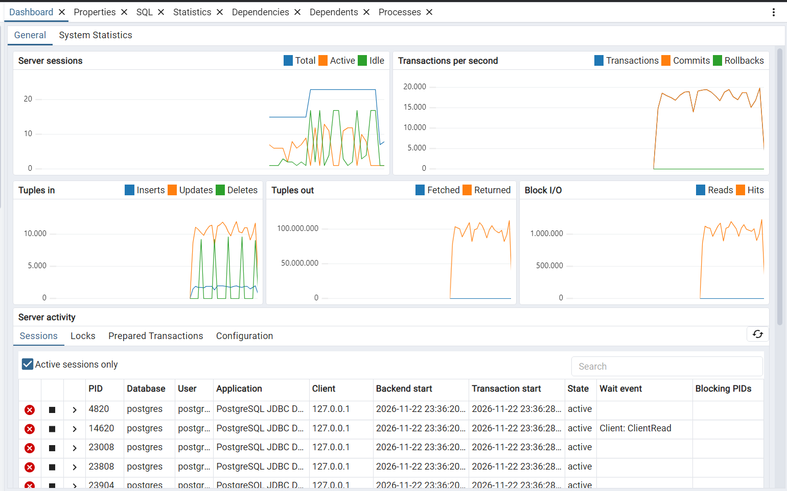
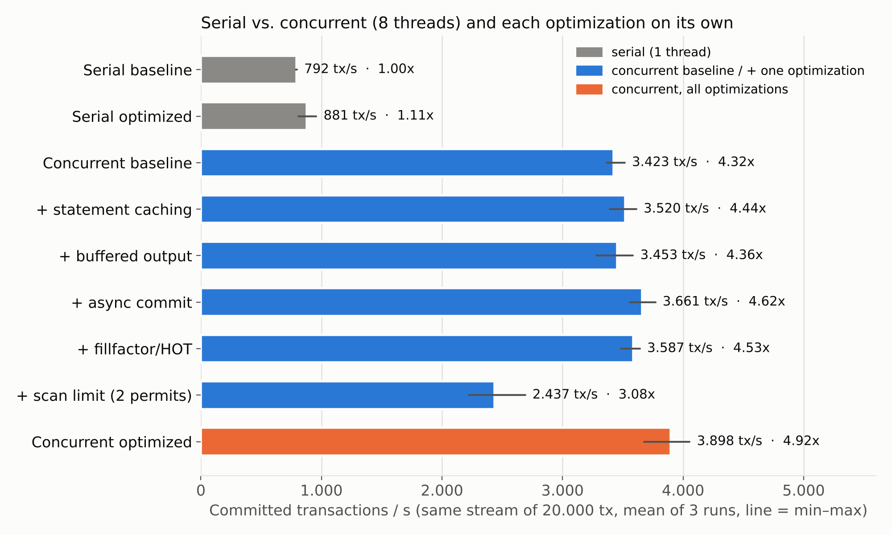

# Advanced Database – Homework 3: Benchmark Extension & Bottleneck Optimization

Solution for **Homework 3 ("Homework 2 revisited")**, based on PostgreSQL and Java JDBC.

> **Results:** all numbers below come from one complete `--all` run on 2026-11-22
> (raw data: `results/results.csv`, one line per run). Machine: Windows, 12 logical CPU cores,
> PostgreSQL 16 on localhost, JDK 21. Charts and screenshots: `results/figures/`.

---

## 📁 Project structure

```text
├── lib/postgresql-42.2.18.jar      PostgreSQL JDBC driver
├── src/
│   ├── TransactionType.java        Dice p -> transaction type (Task 1.1)
│   ├── TxSpec.java                 One generated transaction (type, tuples, values)
│   ├── BenchmarkConfig.java        All switches of a run (baseline / optimized / ablation)
│   ├── WorkloadRunner.java         Benchmark engine: continuous & fixed stream, retries
│   ├── BenchmarkMetrics.java       Throughput, restarts, latency & time share per type
│   ├── TableStats.java             Table size, HOT updates, scan time before/after a run
│   ├── BenchmarkSuite.java         CLI: --demo, --scaling, --serial, --compare, --all
│   ├── ExtendedBlockingBenchmark.java   Entry point: baseline variant
│   ├── OptimizedBenchmark.java     Entry point: optimized variant
│   └── ConnectionFactory.java      JDBC connection, credentials from .env
├── sql/analysis.sql                EXPLAIN, bloat, logging, pg_stat_statements (Task 2.2)
├── results/results.csv             Created by the suite – one line per run
├── results/figures/                Charts and screenshots used in the talk
├── schema.sql
└── .env.example                    Copy to .env and enter your credentials
```

---

## 🚀 Compile & run

**1. Credentials:** copy `.env.example` to `.env` and fill in `PGDATABASE`, `PGUSER`, `PGPASSWORD`.
The table `blocking_data` (50,000 tuples, as in Homework 2) is created automatically if it does not exist.
The database user must own the table (the suite runs `ALTER TABLE` and `VACUUM FULL`).

**2. Compile**
```bash
javac -cp "lib/postgresql-42.2.18.jar" -d bin src/*.java
```

**3. Run** – classpath separator is `;` on **Windows** and `:` on **macOS/Linux**:

| Task | Windows (PowerShell) |
|---|---|
| 1.4 Live demo (30 s) | `java -cp "bin;lib/postgresql-42.2.18.jar" BenchmarkSuite --demo` |
| 1.3 Thread scaling | `java -cp "bin;lib/postgresql-42.2.18.jar" BenchmarkSuite --scaling` |
| 2.1 Serial execution | `java -cp "bin;lib/postgresql-42.2.18.jar" BenchmarkSuite --serial` |
| 2.1/2.3/2.4 Comparison + ablation | `java -cp "bin;lib/postgresql-42.2.18.jar" BenchmarkSuite --compare` |
| Everything | `java -cp "bin;lib/postgresql-42.2.18.jar" BenchmarkSuite --all` |

Options: `--threads 1,2,4,8,16` · `--duration 20` · `--warmup 5` · `--tx 20000` · `--reps 3` · `--seed 42` · `--scan-permits 2` · `--no-print` (debugging only).

**Progress while it runs:** before every run a banner shows `RUN x of y`, the elapsed time and an
estimate of the remaining time; during a run a `>>> [STATUS]` line appears every second
(committed transactions, tx/s, deadlock restarts).

**Tip for the long runs (`--all`, `--compare`, `--scaling`):** every read transaction prints its sum,
so thousands of lines per second scroll by. Redirect the sum output into a log file:
```powershell
java -cp "bin;lib/postgresql-42.2.18.jar" BenchmarkSuite --all > all_log.txt
```
The console then shows only the progress banners, the status lines and the final result tables;
the sums and per-run summaries are in `all_log.txt`, all numbers also in `results/results.csv`.
Run all variants the same way (all redirected, or all in the console), so they stay comparable.
For the live demo, run in the console without redirection.

---

## 📝 Part 1: Extend the benchmark

### 1.1 Realistic workload (`TransactionType`, `TxSpec`, `WorkloadRunner.execute`)
For each transaction, `p ~ U[0,1)` is diced i.i.d.:

| p | Share | Transaction |
|---|---|---|
| p < 0.6 | 60 % | **Multi-point read:** reads `data_value` of 3 distinct random tuples, one statement per tuple (`SELECT data_value FROM blocking_data WHERE data_id = ?`), prints the sum at completion |
| 0.6 ≤ p < 0.7 | 10 % | **Insert** of a new tuple (`data_id ≥ 50000`). Inserted tuples are deleted before and after every run |
| 0.7 ≤ p < 0.8 | 10 % | **Full table scan:** `SELECT sum(data_value) FROM blocking_data`, prints the result |
| p ≥ 0.8 | 20 % | **Write:** 3 `UPDATE` statements, each modifies exactly one tuple (`WHERE data_id = ?`) |

The write order is the diced order (no canonical locking). A transaction is generated once
(`TxSpec`), so a restart re-executes exactly the same transaction.

### 1.2 Continuous stream & equilibrium
We use a **closed system**: `N` worker threads, each with its own connection. The moment a
transaction commits, the thread starts the next one ("restart a finished transaction").
Hence the number of transactions in the system is always exactly `N`:
arrival rate = commit rate. By Little's law the throughput is `X = N / R`
(`R` = mean response time), i.e. the database is kept busy without a queue building up.

How we found the equilibrium: an open system (new transactions at a fixed rate λ) is stable only
if λ ≤ throughput; otherwise the queue grows without bound, below it the DB is idle. The closed loop
reaches this point automatically. The status line (committed tx/s per second) stays flat after the
warm-up, which shows the steady state. `N` itself is chosen with the scaling experiment (1.3):
beyond the knee of the curve, more threads only add waiting, not throughput.

### 1.3 Throughput & thread scaling (`--scaling`)
Each configuration: 5 s warm-up (not measured), 20 s measured window, 3 repetitions (mean [min–max]).
Machine: 12 logical CPU cores, client and PostgreSQL 16 on the same machine.

| Variant | Threads | Throughput tx/s | Speedup | Linear | Efficiency | Full scan latency |
|---|---|---|---|---|---|---|
| Baseline | 1 | 742 [569–879] | 1.00 | 1 | 100 % | 7.2 ms |
| Baseline | 2 | 1,408 [1,348–1,476] | 1.90 | 2 | 95 % | 7.7 ms |
| Baseline | 4 | 2,418 [2,329–2,492] | 3.26 | 4 | 82 % | 9.4 ms |
| Baseline | 8 | 3,267 [3,224–3,348] | 4.41 | 8 | 55 % | 15.6 ms |
| Baseline | 16 | 4,177 [4,082–4,310] | 5.63 | 16 | 35 % | 26.4 ms |
| Optimized | 1 | 812 [781–830] | 1.00 | 1 | 100 % | 6.7 ms |
| Optimized | 2 | 1,457 [1,393–1,510] | 1.80 | 2 | 90 % | 7.7 ms |
| Optimized | 4 | 2,489 [2,355–2,588] | 3.07 | 4 | 77 % | 8.9 ms |
| Optimized | 8 | 3,629 [3,619–3,647] | 4.47 | 8 | 56 % | 12.0 ms |
| Optimized | 16 | 3,646 [3,499–3,738] | 4.49 | 16 | 28 % | 23.8 ms |

Observations:
* Nearly linear up to 2 threads, sub-linear from 4 threads on, flat for the optimized variant beyond 8.
* The full scan gets slower the more threads run (7 → 26 ms) and takes 53 % (1 thread) to 70 % (16 threads)
  of the total transaction time. Client threads and PostgreSQL backends share the same 12 cores,
  so with 16 threads (= 16 client threads + 16 backends) the CPU is saturated.
* The first baseline run with 1 thread (569 tx/s) is clearly lower than the other two: the very first
  run of the suite starts with a cold cache / JIT despite the warm-up. This is why we report min–max.



### 1.4 Live demo (`--demo`)
30 seconds, optimized, 4 threads: the status line shows committed transactions and tx/s per
second, the read transactions print their sums, and a summary per transaction type follows at the end.

---

## 🔍 Part 2: Find and eliminate bottlenecks

### 2.1 Serial execution (`--serial`, first row of `--compare`)
The fixed stream of `K = 20,000` transactions (seed 42) is executed by **one** thread, one
transaction after the other. All variants in `--compare` process **exactly the same stream** and are
measured until **all** transactions have committed (every transaction eventually commits: restarts on
deadlock/serialization failure/duplicate key/connection loss with randomized backoff, so no starvation).
Generating the stream and opening the connections happen before the clock starts (allowed by the task).

### 2.2 Bottleneck analysis
Tools used:
1. **Per-type latency and time share** (printed after every run): which transaction type consumes
   the transaction time?
2. **Table statistics** before/after each run (`TableStats`): size, HOT updates, full-scan time.
3. **PostgreSQL:** `sql/analysis.sql`: `EXPLAIN (ANALYZE, BUFFERS)`, bloat check, `log_lock_waits`,
   `log_min_duration_statement`, `pg_stat_statements`, `pg_stat_activity` wait events.
4. **Java profiler (Java Flight Recorder):**
   ```bash
   java -XX:StartFlightRecording=duration=60s,filename=baseline.jfr -cp "bin;lib/postgresql-42.2.18.jar" BenchmarkSuite --run baseline --threads 8 --duration 40
   ```
   Open `baseline.jfr` in JDK Mission Control → *Threads* / *Lock Instances* / *Socket I/O*.
   Result (baseline, 8 threads, 40 s; `jfr view hot-methods`, `contention-by-site`, `native-methods`):
   only 13 samples executing Java code in 50 s, so the client hardly computes; no monitor contention above
   the 20 ms recording threshold; native time: 81 % `Net.poll` (waiting for PostgreSQL to answer), 11 % socket
   writes (sending queries), 5 % `FileOutputStream.writeBytes` (console output). The client waits for the
   database, mostly for the full scans.






Findings (8 threads, numbers from `--compare`):

| # | Bottleneck | Evidence | Fix |
|---|---|---|---|
| 1 | **Full table scans** dominate: 10 % of the transactions, 59–64 % of the transaction time | time share per type; scan 13.7 ms vs. point read 0.9 ms; EXPLAIN: Seq Scan over all pages vs. Index Scan | none that helped (scan limit made it worse, see 2.4) |
| 2 | **WAL flush on every COMMIT** | insert latency 0.90 ms → 0.48 ms, update 1.47 ms → 1.04 ms with async commit | `SET synchronous_commit = off` |
| 3 | **Statement re-preparation** per transaction | small gain (+3 %) | prepare once per connection |
| 4 | **Synchronous console output** | pgAdmin: backends wait in `ClientRead` (= DB waits for the client); in the console the baseline loses 19 % | 64 KB buffered stream: optimized +43 % vs. baseline in the console |
| 5 | **Table growth** by row versions of UPDATEs | 2.49 MB → 2.70 MB within one 6 s run | `fillfactor = 70` (HOT updates) – but makes the table 44 % larger from the start |
| 6 | Lock contention / deadlocks | 0 deadlock restarts in all 57 runs; no blocking PIDs in pgAdmin | not a bottleneck anymore (single-tuple updates instead of HW2's range updates) |

### 2.3 Solutions (`BenchmarkConfig.optimized()`)
Each optimization is a separate switch so its effect can be measured on its own (ablation):
`cacheStatements`, `bufferedOutput`, `asyncCommit`, `tunedTable` (fillfactor 70 + autovacuum),
`scanPermits` (semaphore limiting concurrent full scans; only enable it if the ablation shows a gain).

Trade-off of `synchronous_commit = off`: a crash can lose the last ~hundreds of milliseconds of
committed transactions (no corruption, but durability is relaxed). This must be mentioned in the talk.

### 2.4 Comparison (`--compare`, same stream of 20,000 transactions, 8 threads, 3 reps)

| Variant | Threads | Optimizations | Time s | Throughput tx/s (mean [min–max]) | Speedup vs serial |
|---|---|---|---|---|---|
| Serial baseline | 1 | none | 25.25 | 792 [786–797] | 1.00x |
| Serial optimized | 1 | all | 22.82 | 881 [810–958] | 1.11x |
| Concurrent baseline | 8 | none | 5.85 | 3,423 [3,365–3,516] | 4.32x |
| + statement caching | 8 | cache | 5.69 | 3,520 [3,392–3,613] | 4.44x |
| + buffered output | 8 | buffer | 5.80 | 3,453 [3,280–3,585] | 4.36x |
| + async commit | 8 | async | 5.47 | 3,661 [3,558–3,771] | 4.62x |
| + fillfactor/HOT | 8 | table | 5.58 | 3,587 [3,482–3,643] | 4.53x |
| + scan limit (2) | 8 | scan2 | 8.26 | 2,437 [2,223–2,691] | 3.08x |
| Concurrent optimized | 8 | all (without scan limit) | 5.14 | 3,899 [3,676–4,055] | 4.92x |

Every variant processed the identical stream of 20,000 transactions; 0 deadlock restarts in all runs.



Separate the two effects in the talk:
* **Parallelism:** concurrent optimized ÷ serial optimized
* **Optimizations:** concurrent optimized ÷ concurrent baseline

Results:
* **Parallelism:** concurrent optimized ÷ serial optimized = 3,899 / 881 = **4.4x** with 8 threads.
* **Optimizations:** concurrent optimized ÷ concurrent baseline = 3,899 / 3,423 = **+14 %**.
  The big win is running transactions concurrently, not the individual optimizations.

**Unexpected results** (discussed in the talk):
1. **The scan limit hurts (−29 %).** Idea: fewer concurrent scans → less interference with the short
   transactions. Reality: with 12 cores the scans could run in parallel; the semaphore serializes them,
   scan latency doubles (13.7 → 25.5 ms) and the threads queue behind it.
2. **fillfactor = 70 is a trade-off.** It enables HOT updates, but leaves 30 % free space on every page,
   so the table starts 44 % larger (2.49 → 3.59 MB) and every full scan reads more pages. Within our
   short runs the table grew by the same ~0.2 MB with and without it, so the advantage
   (less bloat over a long run) does not show yet – the net effect is within the noise.
   A longer 40 s baseline run shows the effect: the table grew from 2.5 to 3.4 MB and the full scan slowed
   from 7.6 to 12.1 ms.
3. **With 16 threads the baseline beats the optimized variant** (4,177 vs. 3,646 tx/s). With 16 client
   threads + 16 backends on 12 cores the CPU is saturated and the full scan dominates (70 % of the
   time); the larger table from fillfactor makes exactly this scan more expensive.
4. **Buffered output brought nothing in `--all`** – because stdout was redirected into a file, which is
   already cheap. Measured again in the console (see the extra measurement below), the synchronous output
   costs the baseline 19 % and the optimized variant is +43 % faster: the "same" bottleneck depends on
   where the output goes.
5. **Serial optimized is only 11 % faster than serial baseline**, although async commit alone halves
   the write latency: writes are only 30 % of the transactions; the scans dominate.
6. **No deadlocks at all**, in contrast to HW2. HW2 used range updates
   (`WHERE data_value BETWEEN ...`, thousands of rows per statement); HW3 updates single tuples,
   so two transactions almost never touch the same rows in conflicting order.

**Extra measurement: console output instead of a log file** (8 threads, same stream of 20,000 tx,
1 run each, sums printed live in the VS Code terminal; screenshots `results/figures/Bild9_Console_Baseline.png`,
`results/figures/Bild10_Console_Optimized.png`):

| Variant | Throughput tx/s | vs. same variant with output into a file |
|---|---|---|
| Concurrent baseline, console | 2,782 | −19 % (3,423) |
| Concurrent optimized, console | 3,969 | ≈ same (3,899) |

In the console the optimized variant is **+43 %** faster than the baseline (vs. +14 % with a log file).
The synchronous console output really is a "trivial" bottleneck: it costs the baseline 19 %, while the
buffered stream of the optimized variant makes the cost disappear. Only one run each, so treat the
exact percentages with care. HOT updates: 86 % even without fillfactor, 100 % with fillfactor = 70.

Background for statement caching: pgjdbc switches a `PreparedStatement` object to a server-side
prepared statement only from its 5th execution on (`prepareThreshold = 5`), so statements re-created
per transaction are re-parsed and re-planned by PostgreSQL every time.

---

## 🎤 Talk outline (slides go to Blackboard)

1. Team & **individual contribution per member (in %)**
2. Goal and general idea: from artificial deadlock workload (HW2) to realistic mix (HW3)
3. Workload & continuous stream / equilibrium (1.1, 1.2)
4. Live demo, 30 s (1.4)
5. Thread scaling chart + discussion (1.3)
6. Bottleneck analysis: tools and findings (2.2)
7. Optimizations and their individual effect: ablation table (2.3)
8. Serial vs. concurrent comparison and **unexpected results** (2.4)
9. Most important issues we faced
10. Sources / use of AI tools (required by the FAQ)
